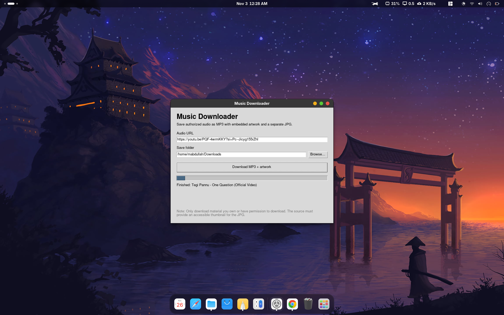

# Audio Downloader

A lightweight desktop application built with **Python and Tkinter** for saving audio as MP3, embedding available thumbnail artwork into the audio file, and keeping a separate JPG cover image.

The application uses [yt-dlp](https://github.com/yt-dlp/yt-dlp) to retrieve media from supported sources and [FFmpeg](https://ffmpeg.org/) for audio conversion and artwork processing.

> **Use responsibly:** Download only material that you own, have permission to download, or that is otherwise legally available for downloading. You are responsible for complying with copyright law and the terms of the website or service you use. This project does not bypass DRM, paywalls, or access restrictions.

## Features

- Simple desktop interface made with Python Tkinter.
- Paste a supported media URL and choose an output folder.
- Convert downloaded audio to high-quality MP3.
- Embed available thumbnail artwork in the MP3 metadata.
- Convert and save the thumbnail as a separate JPG when the source provides one.
- Show download progress and status messages.
- Avoid downloading an entire playlist when a single URL is supplied.

Artwork availability and download support depend on the source website and the media item.

## Screenshot



## Supported operating systems

| Operating system | Status |
|---|---|
| Arch Linux | Primary development/test environment |
| Other Linux distributions | Expected to work when Python, Tkinter, yt-dlp, and FFmpeg are installed; not yet verified on every distribution |
| Windows 10/11 | Should be usable with Python, Tkinter, yt-dlp, and FFmpeg installed; not yet packaged as a Windows installer |
| macOS | Should be usable with Python, Tkinter, yt-dlp, and FFmpeg installed; not yet packaged as a macOS app |

The included `install.sh` installer is for **Arch Linux only**. On Windows and macOS, follow the manual setup instructions below.

## Requirements

- Python 3.10 or newer recommended.
- Tkinter (usually provided by the operating system's Python Tk package).
- yt-dlp.
- FFmpeg (including `ffmpeg` and `ffprobe`).

## Installation

### Arch Linux (using the included installer)

1. Download or clone this repository:

   ```bash
   git clone https://github.com/YOUR_GITHUB_USERNAME/music-downloader.git
   cd music-downloader
   ```

2. Run the installer:

   ```bash
   chmod +x install.sh
   ./install.sh
   ```

3. Open your desktop application menu and search for **Music Downloader**.

The installer uses `pacman` to install dependencies, copies the app into your user-local application data directory, and creates a GNOME/application-menu launcher. It does not need to put the application source under `/opt`.

### Arch Linux (manual installation)

```bash
sudo pacman -S --needed python tk yt-dlp ffmpeg
python music_downloader.py
```

### Ubuntu / Debian (manual setup)

Install Python, Tkinter, and FFmpeg:

```bash
sudo apt update
sudo apt install python3 python3-tk ffmpeg
```

Install yt-dlp for the Python interpreter you will use. One option is a virtual environment:

```bash
python3 -m venv .venv
source .venv/bin/activate
python -m pip install -r requirements.txt
python music_downloader.py
```

### Fedora (manual setup)

Install system dependencies, then use a virtual environment for the Python package:

```bash
sudo dnf install python3 python3-tkinter ffmpeg
python3 -m venv .venv
source .venv/bin/activate
python -m pip install -r requirements.txt
python music_downloader.py
```

Package names and FFmpeg availability can vary by Fedora release and enabled repositories.

### Windows 10 / 11 (manual setup)

1. Install Python 3 from [python.org](https://www.python.org/downloads/). Tkinter is included with the standard Windows installer.
2. Install FFmpeg and make sure `ffmpeg` and `ffprobe` are available on your `PATH`.
3. Open PowerShell in the project folder and run:

   ```powershell
   py -m venv .venv
   .venv\Scripts\Activate.ps1
   py -m pip install -r requirements.txt
   py music_downloader.py
   ```

If PowerShell blocks environment activation, you can run the commands using the Python executable inside `.venv` directly, or use Command Prompt and `.venv\Scripts\activate.bat`.

### macOS (manual setup)

1. Install Python 3 from [python.org](https://www.python.org/downloads/) or another trusted distribution that includes Tk support.
2. Install FFmpeg, for example with Homebrew:

   ```bash
   brew install ffmpeg
   ```

3. In the project folder, create an environment and install the Python dependency:

   ```bash
   python3 -m venv .venv
   source .venv/bin/activate
   python -m pip install -r requirements.txt
   python music_downloader.py
   ```

If your Python installation does not include Tkinter, install a Python distribution with Tcl/Tk support.

## How to use

1. Launch **Music Downloader**.
2. Paste a URL from a source supported by yt-dlp, provided you are authorized to download that content.
3. Choose the folder where you want the files saved. The default is your `Music` folder.
4. Click **Download MP3 + artwork**.
5. Wait for the conversion and metadata processing to finish.
6. Check the selected folder for the MP3 and, when available, the separate JPG artwork.

The artwork is embedded in the MP3 when the source provides a usable thumbnail. Some sources do not provide artwork, and some media may not be downloadable.

## Troubleshooting

### `yt_dlp` module is missing

Install the Python dependency in the same Python environment used to launch the app:

```bash
python -m pip install -r requirements.txt
```

On Arch Linux, the system package can also be installed with:

```bash
sudo pacman -S yt-dlp
```

### FFmpeg is missing

Install FFmpeg using your operating system's package manager and confirm that both `ffmpeg` and `ffprobe` are available on your `PATH`.

### The application window does not open

Confirm that Python and Tkinter are installed:

```bash
python -c "import tkinter; print('Tkinter is available')"
```

### No JPG artwork appears

The source may not provide a thumbnail, or the thumbnail may not be accessible. Artwork output cannot be guaranteed for every URL.

## Project structure

```text
music-downloader/
├── music_downloader.py
├── install.sh
├── requirements.txt
├── README.md
├── LICENSE
└── .gitignore
```

## Technology

- **Python** — application logic.
- **Tkinter / ttk** — graphical user interface.
- **yt-dlp** — media retrieval from supported websites.
- **FFmpeg** — audio conversion and artwork/metadata processing.

## License

This project is licensed under the **MIT License**. See [LICENSE](LICENSE).

The MIT License applies to this project's original code. Third-party tools and libraries (including yt-dlp and FFmpeg) are distributed under their own licenses and remain subject to those licenses and terms. See their official project pages for details.

Before publishing, replace `YOUR_GITHUB_USERNAME` in the clone URL above with your GitHub username and add your own screenshots.
